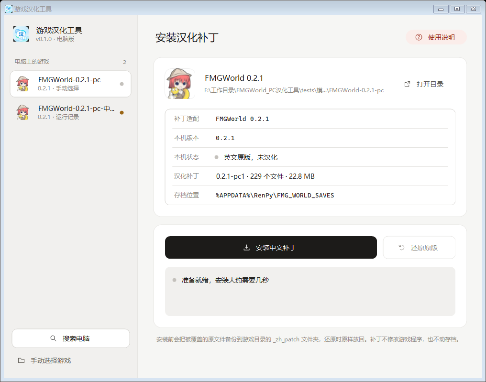

# PC 游戏汉化工具

电脑版游戏汉化补丁的安装工具和补丁发布仓库。目前支持 FMGWorld 0.2.1。



## 下载使用

1. 到 [Releases](../../releases/latest) 下载最新的 zip，解压到任意位置
2. 双击 `FMGPatcher.exe`，工具会自动查找电脑上的游戏；找不到时点"搜索电脑"，或把游戏文件夹拖进窗口
3. 本机版本和补丁适配一致后，点"安装中文补丁"
4. 想恢复英文原版时，点"还原原版"

安装前会把被覆盖的原文件备份到游戏目录的 `_zh_patch` 文件夹，还原时原样放回。补丁不修改游戏程序，也不动存档。

非官方汉化，需自备正版，仅供学习交流，版权归原开发者所有。原游戏含成人内容，仅限 18 岁以上使用。使用前请阅读发布包中的《免责声明》。

---

## 开发

C# WinForms，目标 .NET Framework 4.8（Win10/11 自带），exe 双击即用。界面配色与安卓版汉化工具一致。

## 构建

```powershell
.\build.ps1
```

产物在 `publish\`：`FMGPatcher.exe`、`catalog.json`、`payload\fmgworld-zh-0.2.1.zip`。发布时三样一起打包。
补丁包由 `..\FMGWorld-汉化补丁-0.2.1\game` 打包而来，更新译文后重新构建即可。

## 结构

| 文件 | 作用 |
|---|---|
| `catalog.json` | 支持的游戏、版本识别规则、版本对应的补丁包 |
| `src/Core/GameLocator.cs` | 找游戏：Steam 库 → itch → Windows 运行记录 → 磁盘扫描；也接受手动选择和拖放 |
| `src/Core/GameInspector.cs` | 读版本（`options.rpy` 的 `config.version`）、判断是否已汉化、检测游戏是否在运行 |
| `src/Core/PatchEngine.cs` | 安装 / 还原：备份 → 临时文件替换 → 哈希校验；失败自动回滚 |
| `src/UI/*` | 界面，自绘控件 |

注意：`game/script_version.txt` 里记录的是 Ren'Py 引擎版本 `(8, 5, 3)`，不是游戏版本。

## 命令行（提权和测试用）

```
FMGPatcher.exe --scan
FMGPatcher.exe --status    "游戏目录"
FMGPatcher.exe --install   "游戏目录"
FMGPatcher.exe --uninstall "游戏目录"
FMGPatcher.exe --render out.png ["游戏目录"]   # 把界面画成图片
```

## 加新游戏或新版本

在 `catalog.json` 里加一个 `games` 项或一个 `patches` 项，补丁 zip 放进 `payload\`。
需要精确校验原版时，在 `requiredFiles` 里填关键文件的 `size` / `sha256`。
